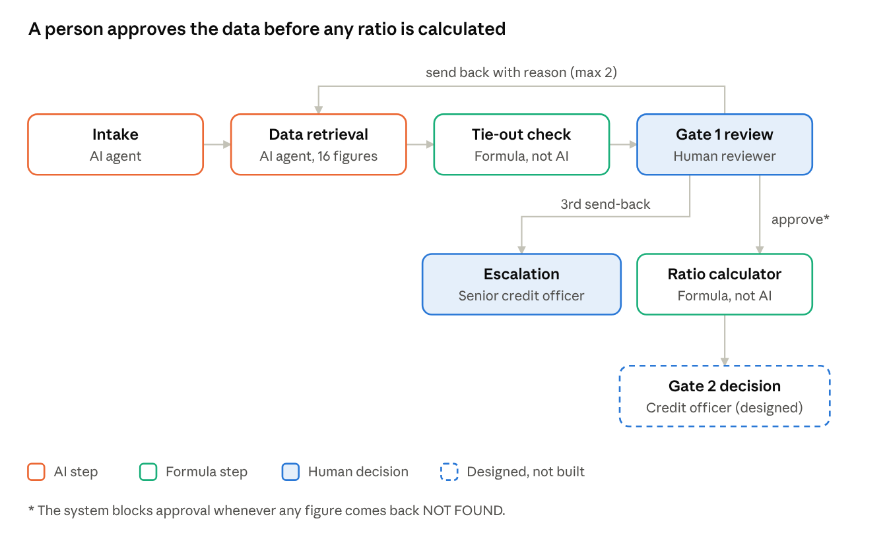

# Governing an AI-Assisted Credit Memo Workflow

A banking AI governance case study. I built a small AI-assisted workflow that prepares the financial data behind a commercial credit memo, then tested it the way a bank's model risk team would: trying to break it, and adding controls until it held.

**Read the case study:** [case-study/AI-Assisted-Credit-Memo-Case-Study.pdf](case-study/AI-Assisted-Credit-Memo-Case-Study.pdf)

## What it does

1. **Intake (AI):** captures the loan request and flags anything missing or suspicious.
2. **Data retrieval (AI):** pulls 16 financial figures from a company's 10-K, each with a page citation, or says NOT FOUND.
3. **Tie-out check (formula):** confirms the income statement figures add up before anyone reviews them.
4. **Gate 1 (human):** a reviewer approves the data or sends it back. After two send-backs, the case escalates to a senior credit officer. The system blocks approval if any figure is missing.
5. **Ratio calculator (formula):** computes five credit ratios, only after approval.

Test borrower: Microsoft Corporation, using its public FY2026 10-K ([SEC EDGAR](https://www.sec.gov/cgi-bin/browse-edgar?action=getcompany&CIK=0000789019&type=10-K)). No customer or personal data was used.

## What testing found

- **The AI made up a number and cited a real page for it:** operating income of $188.3B instead of $155.2B. Fixed with a self-check, a formula tie-out and human spot checks.
- **It mapped the wrong line item:** lease interest reported as interest expense, which would have overstated interest coverage (60.9x vs. 50.9x).
- **A reviewer approved data that was entirely missing.** The workflow now blocks approval automatically when any figure is NOT FOUND.
- **A formula "passed" on empty data.** It now shows INPUT MISSING - FAIL instead.
- **Final result:** all 16 figures correct on every run, and every ratio matched a hand-calculated answer key.

An independent review then pointed out the core dependency: every control still trusts a dataset the AI created. A governed financial-data source is the top step toward production (case study, section 8).

## Repository contents

| Folder | Contents |
| --- | --- |
| `case-study/` | The full case study (PDF) |
| `exhibits/` | Workflow diagram and test screenshots (Exhibits A to F) |
| `workflow/` | Agent instructions, JSON output schema, Power Fx formulas and workflow logic |
| `testing/` | Full test log and answer keys |

## Built with

- Microsoft Foundry (agents and visual workflows), no code
- Model: gpt-5.4-mini, version 2026-03-17
- Ratio and tie-out logic: Power Fx formulas inside the workflow

Note: Foundry workflows are scheduled for retirement on December 1, 2026. A production version would move to Azure Logic Apps or Microsoft Agent Framework.

## Status

Prototype. Developer testing complete for four built steps; research, memo drafting, a critic step and the final credit decision (Gate 2) are designed but not built. Not validated or approved for production use.

## Contributing

Please work on a branch and open a pull request rather than editing `main` directly, so each change can be reviewed.

## Disclaimer

A learning and portfolio project. Nothing here is credit, investment or financial advice.
